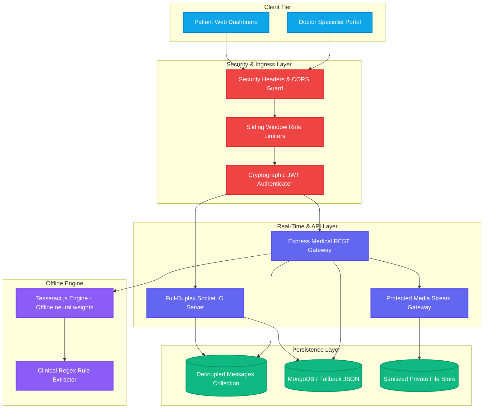

# 🌟 AI-DOCTOR: Advanced Clinical Network & Triage Workspace

A production-grade, secure MERN medical platform connecting patients and clinical professionals. Features real-time triage, airgapped local OCR report extraction (Zero external APIs), full-duplex WebSocket consultations with encrypted media exchange, decoupled scalable messaging architectures, and comprehensive security hardening.

---

## 🚀 System Architecture & Clinical Data Flow



---

## 🛡️ Production Security Hardening

| Feature | Implementation | Benefit |
| :--- | :--- | :--- |
| **HTTP Security Headers** | Native Helmet-grade zero-dependency middleware | Enforces `X-Content-Type-Options: nosniff`, `X-Frame-Options: DENY`, `Strict-Transport-Security`, and strict `Content-Security-Policy`. |
| **Private File Gateway** | `GET /api/files/:filename` & `GET /uploads/:filename` | Public static directory removed. All prescription scans, audio dictations, and lab PDFs require valid JWT credentials to stream. |
| **Magic Byte Signature Inspection** | First 16-byte header inspection | Rejects malicious executables and shell scripts disguised with fake `.png`, `.jpg`, or `.pdf` extensions. |
| **Path Traversal Guards** | File name sanitization (`sanitizeFilename`) | Strips relative path sequences (`../`, `..\\`) and illegal characters before storing or serving files. |
| **IDOR Access Control** | Ownership verification middleware | Verifies `req.user.id` against consultation participants (`patientId`, `doctorId`) to prevent cross-account tampering. |
| **Sliding Window Rate Limiters** | Memory leak-guarded timers | Protects `/api/auth/login`, `/api/auth/register`, `/api/auth/send-otp`, and `/api/*/chat` against brute-force and quota attacks. |
| **Socket.IO Cryptographic Handshake** | `verifySocketAuth` middleware | Requires cryptographic JWT in handshake auth, query, or headers. Rejects unauthenticated connections before room entry. |

---

## ✨ Clinical Core Capabilities

### 🩺 Patient Workspace
* **🏥 Empathetic Triage Bot**: Evaluates symptoms in real-time, assigning dynamic color-coded urgency classifications (Low, Medium, or Emergency High).
* **📑 Airgapped Local OCR & Report Extraction (Zero External APIs)**:
  * **100% On-Device / In-Process OCR**: Recognizes text from prescriptions & lab reports using local `Tesseract.js` paired with fast offline English neural weights (`eng.traineddata`). No external vision APIs or cloud calls.
  * **Deterministic Clinical NLP**: Rule-based extractor matches diagnosed conditions (30+ canonical entities), prescribed medications (dosages, durations, frequencies), and abnormal biomarkers (glucose, HbA1c, lipids, creatinine, liver enzymes) against clinical normal ranges.
  * **Airgapped Privacy**: Sensitive patient diagnostic documents never leave the local server boundary.
* **🔊 Local Bilingual Voice Summarizer**: Compiles report findings into plain English and Hindi audio summaries directly in-browser using the Web Speech API.
* **📈 Demographics & Vitals Timeline**: Logs monthly blood pressure and blood sugar readings with interactive dual-axis Chart.js visualizations.

### 🥼 Doctor Specialist Workspace
* **👥 Active Patient Directory**: Visualizes patient status with dynamic risk-category badges, latest vitals, and medical history.
* **💬 Full-Duplex Consultation Rooms**: Real-time WebSockets via Socket.IO with typing indicators, presence tracking, and instant delivery.
* **📎 Encrypted Media & Document Sharing**: Secure exchange of files up to 25MB:
  * **Medical Scans & Images**: Interactive inline thumbnails with full-screen Lightbox zoom, rotation, and high-resolution view.
  * **PDF & Lab Reports**: Formatted document preview cards with file size indicators and in-browser viewing.
  * **Voice Dictation Notes**: In-chat microphone recorder and embedded audio player for quick clinical instructions.
  * **Video Streams**: Embedded responsive video player for clinical demonstrations.
* **🔔 Push Notifications**: Real-time push alerts for incoming consultation requests and status updates.

---

## 💾 Decoupled Database Architecture

To prevent MongoDB 16MB document size limits and unbounded array growth, consultation messages are decoupled into a dedicated collection:

* **Collection**: `Message` (`backend/models/Message.js`)
* **Compound Index**: `{ consultationId: 1, createdAt: 1 }`
* **Fields**: `consultationId`, `senderId`, `senderName`, `content`, `fileUrl`, `fileName`, `fileType`, `fileSize`, `timestamp`, `createdAt`.
* **Zero-Downtime Dual-Write**: Automatically preserves compatibility with legacy document arrays and fallback JSON mode (`db.json`).

---

## 🛠️ Technology Stack

* **Frontend**: React 18, Vite, Socket.IO Client, Chart.js, HTML5 Canvas, Vanilla CSS.
* **Backend**: Node.js, Express.js, Socket.IO, JSON Web Tokens (JWT), bcryptjs.
* **Database**: MongoDB (Mongoose) with automatic JSON-file fallback storage.
* **Local OCR**: Tesseract.js with offline `eng.traineddata` (Zero external APIs).
* **AI Engine**: Google Gemini Multimodal API (Triage and pharmacological risk analysis).

---

## ⚙️ Quick Start & Installation

### 1. Prerequisites
* Node.js v18+ (tested on Node.js v20 and v24)
* MongoDB (optional, automatic JSON file fallback enabled if MongoDB is offline)

### 2. Installation
```bash
# Clone the repository
git clone https://github.com/yogeshswami0/AI-DOCTOR.git
cd AI-DOCTOR

# Install root, backend, and frontend dependencies
npm run install-all
```

### 3. Configure Environment Variables
Create a `.env` file in the `backend/` directory (or use `.env.example` as a template):
```env
PORT=5000
NODE_ENV=production
MONGODB_URI=mongodb://127.0.0.1:27017/aidoctor
JWT_SECRET=your_super_secure_random_jwt_secret_key_here
GEMINI_API_KEY=your_gemini_api_key_here
CORS_ORIGINS=http://localhost:5173,http://localhost:5000
```

### 4. Run Automated Security & Integration Tests
```bash
npm test
```
Runs the automated test suite verifying security headers, token verification, role guards, sliding-window rate limiters, magic byte inspection, and database schemas.

### 5. Build for Production
```bash
npm run build:frontend
```

### 6. Start the Platform
```bash
# Start backend and frontend concurrently in development mode
npm run dev

# Or start the production server directly
npm start
```
* **Patient & Doctor Dashboard**: [http://localhost:5173](http://localhost:5173)
* **Backend REST Gateway & WebSockets**: [http://localhost:5000](http://localhost:5000)
* **Health & Diagnostics Telemetry**: [http://localhost:5000/api/health](http://localhost:5000/api/health)

---

## 🔒 Production Verification & Health Telemetry

Verify server health at any time:
```bash
curl http://localhost:5000/api/health
```
```json
{
  "status": "healthy",
  "timestamp": "2026-11-14T07:48:19.000Z",
  "uptimeSeconds": 342,
  "environment": "production",
  "database": {
    "type": "mongodb_mongoose",
    "connected": true
  },
  "system": {
    "nodeVersion": "v24.12.0",
    "memoryRssMb": 64,
    "heapUsedMb": 38
  }
}
```

---

## 🌐 Official Platform Website
[https://ai-doctor-1fy2.onrender.com](https://ai-doctor-1fy2.onrender.com)

---

## 📄 License & Intellectual Property
© 2026 AI-DOCTOR Secure Medical Network. All rights reserved.  
**Lead Architect & Developer**: YOGESH SWAMI
